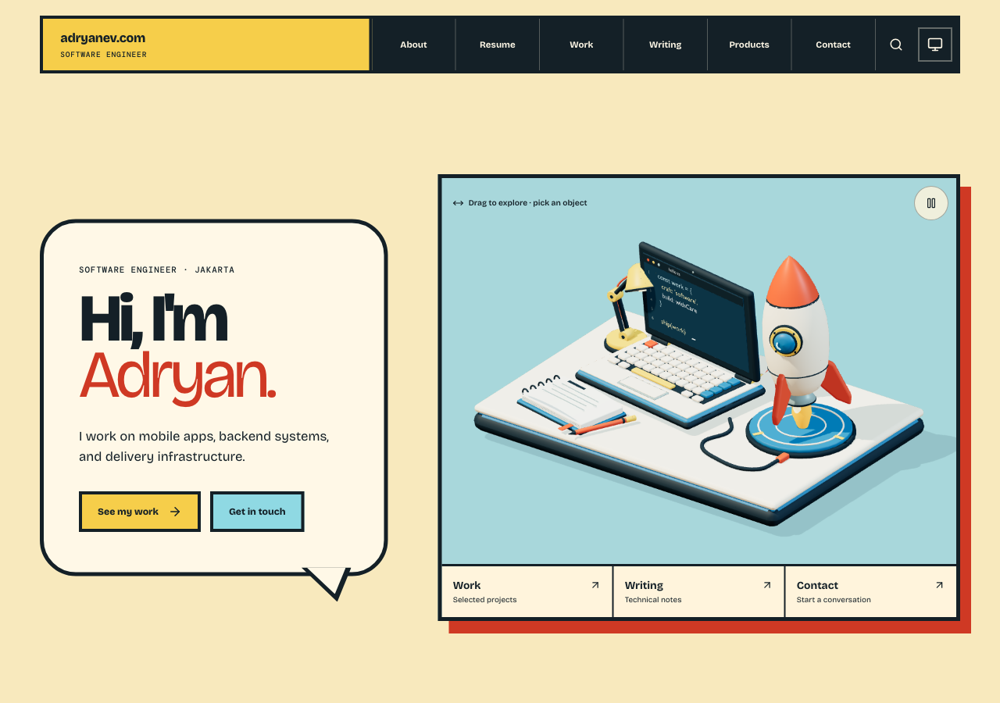
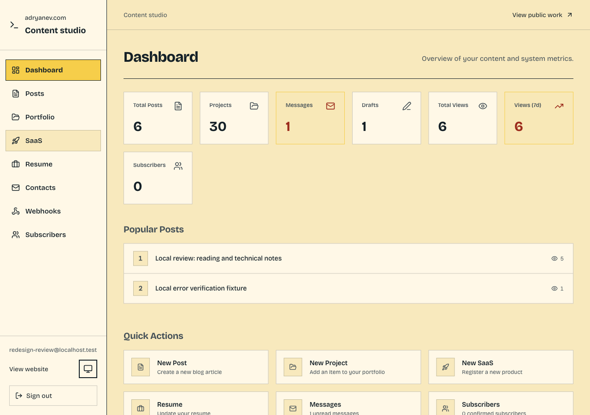

# Full redesign verification

Updated 2026-10-14. The implementation is an ordinary extension of the approved coding-adventure world. `PRODUCT.md`, `DESIGN.md`, and `.impeccable/design.json` remain unchanged by this documentation pass.

## Design consistency

The documenter compared the token-bearing `DESIGN.md` frontmatter and sidecar against `src/app.css`, `src/components/layout/public-pages.css`, and `src/components/admin/admin.css`. The light palette matches the documented ink, paper, warm ground, red, yellow, blue, and secondary text values. Bricolage Grotesque and DM Mono retain their documented roles. The 80rem public container, 820px and 560px responsive rules, chapter shadows, and 160ms feedback and 260ms settling motion are present in CSS. Dark mode retains the semantic color roles through its existing alternate values.

Public reading pages, forms, search, and Terminal extend the paper panels and square controls. Admin uses the same fonts and semantic palette with restrained yellow actions, a navigation rail, ordinary tables, and labeled editors. These are route adaptations of the incumbent system. They do not establish a replacement concept or a new global token scale.

The existing sidecar is a partial component catalog with two examples. It does not contain a complete canonical control library or tonal ramps, and its narrative is shorter than the Markdown. Some CSS has existing small-radius editor and inline-code exceptions to the broad square-corner prose. This pass records that pre-existing documentation coverage without changing the design system or repairing drift.

## Local evidence

The build thread used a local production build at `127.0.0.1:3002`, the owned `adryanev_work_review` PostgreSQL database, and a dedicated local S3 bucket. Fixture articles, products, uploads, and newsletter records are labeled verification content. Existing factual portfolio and resume records remain authoritative. Database schema and application dependencies are unchanged.

| Scope | Recorded result |
| --- | --- |
| Public | Home, About, Resume, Work, categories, project dossier and gallery, writing and articles, products, Contact, newsletter, navigation, search, Terminal, and loading, error, and missing-page views implemented |
| Admin | Login, dashboard, posts, projects, categories, products, resume, messages, subscribers, webhooks, delivery logs, and shared editors implemented |
| Browser workflows | Login rejection and success, dirty-edit cancellation, Markdown import and draft save, S3 gallery upload and save, contact submission, category and product mutations, inactive webhook save, newsletter subscribe, valid confirmation, and unsubscribe recorded as passing locally |
| HTTP and checks | Build thread reports 30 successful pages, 18 protected admin leaves, draft and missing-page 404s, nine passing tests, passing typecheck, and a passing final production build after the Terminal correction |
| Finish review | Admin full review returned `ship`. Public full review requested one fix for joined Terminal footer labels at 390px. After wrapping and gaps, the reviewer scored the sole fix resolved and returned `ship` at that scope |

These workflow results come from the build thread and retained evidence. The documenter did not rerun browser workflows or tests.

Evidence remains in the original checkout under `.impeccable/review/full-redesign/`. `verification.md` records behavior and corrections. `public-captures.json` and `admin-captures.json` index the route captures at 1280px and 390px with representative dark views. `resume-complete.json` and `admin-resume-complete.json` replace the incomplete Resume captures with overlapping segments through the document bottoms. Finish-review reports are `/private/tmp/adryanev-public-finish-review.md` and `/private/tmp/adryanev-admin-finish-review.md`.

## Assets and delivery

The workstation raster has provenance in `public/images/portfolio-atelier.webp.json`, pointing to `assets/blender/portfolio-atelier.blend` and `scripts/blender/portfolio_atelier.py`. About, Resume, and Work poster PNGs have matching local `.blend` sources. Resume also has `assets/blender/render-resume-worktable.py`. The build thread embedded source provenance in the PNG metadata and reports that the absolute-path scan of `public/images` and `public/models` passed for all four shipping rasters with none missing provenance. Verification uploads are local fixtures, not invented project screenshots.

Application work is isolated in `adryanev.com-full-redesign` on `feat/full-coding-adventure-redesign`, based on build repair PR #15. Merge, image publication, deployment, and authenticated production checks remain separate delivery steps. The existing newsletter backend logs confirmation URLs without an email provider. No external email or webhook delivery is claimed.

The final local production build also returned the custom HTTP 500 view for an intentionally corrupt article. After restoring the fixture, its Try again control loaded the article. Resume PDF generation produced a 14,033-byte `application/pdf` blob with a `%PDF-` header. Browser download-manager completion was not exposed by the native preview, so that is not claimed.

